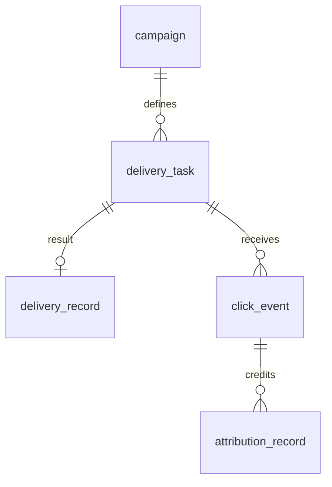
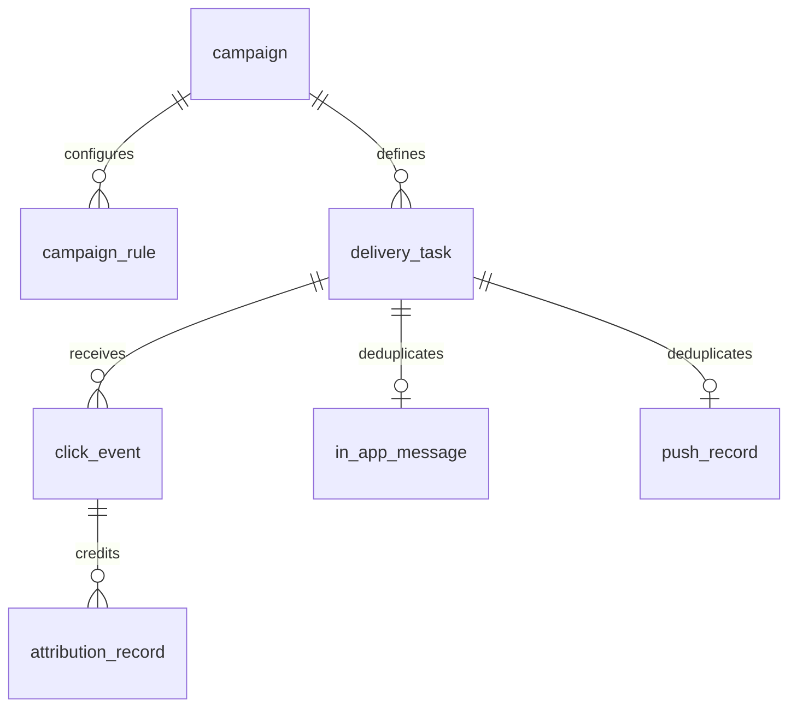

# Delivery Task 合并设计与停机升级

基线：PR #23 已于 2026-11-02 合并；本次从 main `6c89c900e85098d381844fff5cc59b8c613baf34` 开发。V1–V8 不变，新增 Java Flyway V9。没有操作生产数据库。

## 模型与职责

旧关系：

新关系：

任务原先已管理生命周期、错误与重试，而唯一 delivery_record.task_id 只维护 0:1 结果，也没有每次尝试历史。合并消除重复的用户、活动、渠道、结果状态和错误副本，以及独立结果 ID/创建时间和双写一致性。渠道特有记录仍保留，负责站内信内容/已读状态、模拟 Push 内容及业务幂等，不是新的通用结果冗余表。未来确实需要逐次尝试审计时可设计 delivery_attempt，本次不新增。

| delivery_task 字段 | 定义 |
|---|---|
| id / campaign_id / user_id / channel | 触达唯一身份和归属 |
| dedup_key / trigger_event_id / message_content | 决策去重、来源事件与实际发送内容 |
| status | PENDING 待领取；PROCESSING 已领取；SENT 成功；WAIT_RETRY 等待重试；FAILED 终止失败；CANCELLED 取消 |
| dispatch_status / published_at | Kafka 派发 PENDING/PUBLISHED 及确认时间，不代表发送成功 |
| retry_count / next_retry_at | 当前失败恢复次数及允许重新派发的时间；上限 5 |
| processing_at | 本次领取的毫秒时间；结束/失败更新用它限制过期处理者 |
| sent_at | 可验证的实际成功发送时间；失败和未知结果保持 NULL |
| first_send_attempt_at | 已实际进入渠道尝试的单任务标记；历史数据承接旧发送事实的时间窗口 |
| last_error | 最近失败/拒绝原因；成功恢复后清除 |
| created_at / updated_at | 任务创建与状态更新时间 |

仅新增两个发送字段。processing_at 和渠道原有时间精度提升至 DATETIME(3)。新领取、尝试、IN_APP/PUSH 和 EMAIL 模拟发送统一传应用时间，避免 MySQL 会话时间与应用时间不一致。历史时间值不会做猜测性时区平移。

## 发送与恢复

创建任务提交后才发布 Kafka，发布独立事务写 PUBLISHED（确认写库失败也会重投已完成任务以补齐派发状态，终态消费者直接跳过）；进程在提交与发布之间退出，由 DispatchRetryJob 扫描恢复。Kafka 只提供 taskId 唤醒，消费者重新读取数据库的归属、渠道、内容和状态。PENDING→PROCESSING 的条件更新只允许一个消费者领取；重复消息不能重新发送 SENT、FAILED、CANCELLED 或已领取任务。

领取后先读渠道成功事实，再检查频控。IN_APP 的 business_key 和 PUSH 的 business_key 唯一键继续限制重复副作用。发送后重新读 in_app_message.created_at / push_record.pushed_at，以数据库中持久化的原始时间设置 sent_at。冲突记录必须匹配用户、活动与渠道；不存在成功证据时不能宣告成功。渠道归属冲突以 FAILED 终止并留下原因，避免阻塞同批其他恢复任务。markSent 只填空 sent_at，不覆盖已有成功时间。

渠道写入和任务更新分别提交，因此任务写失败时渠道事实仍在。WAIT_RETRY 或超时 PROCESSING 由 RetryCompensationJob 先恢复渠道事实，即使重试次数已到上限、频控变更或额度失效，也先恢复已发送结果；恢复不再次发送、不再次预占频控。真正失败等待五分钟，重置为 PENDING 与 dispatch_status=PENDING 后通过原 Kafka 通道派发。超时或历史缺失领取时间的 PROCESSING 会写可执行的 next_retry_at，避免原先只变状态却永久无法重试的问题。Redis 频控基础设施错误进入 WAIT_RETRY；业务限额拒绝进入 CANCELLED，且不生成发送尝试标记。

EMAIL 仍是日志模拟，不存在 SMTP 或供应商收件证明。发送前在任务上原子预占一次自动尝试；正常模拟完成后记录当前成功时间。若进程在预占后退出，或日志发送成功但结果写库失败，无法恢复可信原始成功时间：状态 FAILED，last_error=EMAIL_SEND_OUTCOME_UNKNOWN，sent_at=NULL，不自动再次发送。不应把该任务当成功或重置尝试标记盲目重发。这是明确的保守能力边界，相比旧路径重试时反复模拟发送、预写 SENT 的做法收紧了不确定结果处理；不宣称外部邮件精确一次。接真实供应商需先落实其幂等键/结果查询能力。

## CLICK、归因和指标

PR #23 的可信服务端来源令牌、用户/任务校验、VALID/REJECTED/PENDING、MARKETING_CLICK 补偿、source_event_id 唯一键及事务回滚全部保留。成功条件为 task.status=SENT 且 sent_at 非空且 sent_at<=effective_event_time。尚未可见的成功继续补偿，恢复使用原时间，所以恢复前已经发生的真实点击不会被恢复时刻错误拒绝。CANCELLED/FAILED 点击按现有规则终止；EMAIL 未知结果不能生成有效点击。

ClickEventMapper 的共享有效性 SQL 只关联 task 和可信 user_event，不再 JOIN 旧结果表。Last-Touch 保留先过滤有效性再排序、24h 窗口、5min 宽限、行锁领取/任务幂等、Redis 恢复及 PENDING 点击阻止提前结束。旧无来源点击与归因明细保留，迁移不授信。

| 指标 | 合并后定义 |
|---|---|
| SENT / sentCount | first_send_attempt_at 非空的任务数，包括失败；不计未尝试任务，也不是逐次重试数 |
| DELIVERED / deliveredCount | 成功 SENT 且 sent_at 非空的任务数 |
| CLICKS / clickedCount | 同一有效性 SQL 下的去重用户数 |
| CONVERSIONS / convertedCount | 同一有效性 SQL 下的有效归因去重用户数 |
| ATTRIBUTED_CONVERSIONS | 有效归因记录数 |
| CTR / CONVERSION_RATE | 分别为 CLICKS/DELIVERED、CONVERSIONS/CLICKS；Java 四位小数 HALF_UP，零分母返回零 |

旧 SENT 名称含失败记录，本次保留该单任务发送尝试口径，不把 COUNT(全部任务) 当 SENT。旧 IN_APP/PUSH 在渠道插入失败且未产生结果行时没有失败可见性；新任务在进入渠道前持久化尝试标记，因此这些真实失败也进入 SENT，这是一致化尝试口径的明确修正，不是统计重试次数。

Agent 时间窗口的发送事实使用 first_send_attempt_at：历史有结果行时逐行承接旧 record.sent_at，保持原期间和 DAY 分组的 SENT/DELIVERED；实际发送时间可从更早渠道事实纠正而不移动旧指标时间。新任务在首次尝试所在时间窗统计，后续成功会更新同一任务的 DELIVERED，因此跨日重试可能修订首次尝试日的成功数。点击/归因仍分别按 click_time/credited_at 过滤；比率不是因果 cohort 转化率。Dashboard/活动发送趋势保留“成功发送时间”口径，改读 task.sent_at；纠正旧恢复时间后其日期可能得到相应纠正。Java 权威聚合、只读/参数化查询、Agent Tool 请求响应及隐私边界不变。

详情 API 保留 record 结果包络，数据由任务投影；未尝试任务返回 null。record.id 明确为 null，不以 taskId 冒充旧 ID；taskId、归属、channel、status、sentAt、errorMessage 保持。结果 status 现在可显示任务的 WAIT_RETRY/FAILED 等生命周期，不再来自独立发送行；前端类型、演示数据与展示同步更新。

## V9 历史规则与失败保护

执行所有歧义预检后才执行任何业务 DDL，异常含原因和最多 20 个记录 ID。以下情况阻止升级，旧表不被删除：

- 孤儿 delivery_record、用户/活动/渠道归属冲突、未知任务渠道、空状态或非法重试次数。
- 旧结果 sent_at 为空，包括无法保留期间口径的失败记录；不使用迁移时间补齐。
- CANCELLED 却有成功结果/渠道事实；FAILED 结果却有 SENT 任务或成功渠道事实。
- 渠道记录归属冲突，或旧成功时间早于持久渠道事实。
- SENT 任务没有结果和渠道成功证据；EMAIL 结果 SENT 但任务未完成 SENT，无法证明预写结果之后真的完成模拟发送。

确定数据迁移规则：

1. 旧成功结果提升任务到 SENT，修复 PENDING/PROCESSING/WAIT_RETRY/FAILED 滞后状态。优先取匹配渠道事实原时间，否则保留旧成功时间；EMAIL 仅迁移任务已确认 SENT 的模拟结果。
2. first_send_attempt_at 保留旧 sent_at；失败结果保持 sent_at=NULL，保留原任务生命周期、次数/退避及最近任务错误，缺失错误时补旧 error_msg。
3. 没有旧结果但有匹配 IN_APP/PUSH 成功事实的任务恢复 SENT，两个时间均取该事实；单独报告 recovered channel-only 数。这是补回旧双写故障的确定成功，不是凭任务状态编造。
4. 无发送证据的普通 PENDING/PROCESSING/WAIT_RETRY/FAILED/CANCELLED 不添加成功或尝试时间。
5. 校验迁移后尝试数=旧记录数+确定恢复数，成功数=旧成功数+确定恢复数，逐行核对旧时间窗口和状态。回填事务提交、索引成功后才最后 DROP delivery_record。保留任务/点击/归因原主键；不改 user_event 信任属性。

迁移测试包含成功、失败、状态滞后、渠道时间纠正、渠道唯一事实、旧可信及无来源点击、旧归因，以及九种拒绝路径、DDL 后回填失败的事务回滚和审计 repair 后续迁。Flyway schema_history 阻止重复执行，并验证 migrate 第二次为 0 与 validate 成功。

## 生产切换与回滚

采用停机切换，不支持新旧消费者/查询实例混跑。运维应在备份恢复演练后：暂停接入与全部旧应用、Kafka 消费者和 XXL-JOB；确认无旧写者；备份旧表及相关任务、点击、归因和 schema_history；运行新应用 Flyway V9；检查预检、旧/新聚合及 recovered 日志；验证 schema_history 与 validate；启动且仅启动新应用和原调度；恢复流量和消费者。全过程保留现有 Kafka offset、Redis 频控/延迟状态，不清空业务事实。

预检失败时依据输出 ID 与独立渠道证据审计修复，不能全表授信、强置 SENT 或删除冲突记录绕过检查。MySQL DDL 非事务：中途失败保持应用停止，检查表/字段/索引和回填事务，人工审计后才 Flyway repair；新增字段/索引有存在检查便于恢复，不能盲目 repair。若 DROP 已完成而 Flyway bookkeeping 未完成，必须检查完整结果再修复版本记录，不应重跑缺少旧表的回填。成功切换后不能只回滚旧应用二进制；需经过恢复演练的数据库备份恢复与 Kafka/外部副作用核对。

DataCleanupJob 不再单独删除通用发送结果；delivery_task 和渠道幂等事实一起保留，避免清掉可靠恢复依据。既有点击 90 天清理策略不变；实时点击/归因有效指标仍受其保留期影响。更长期的任务/渠道联合归档属于后续工作，本次不自动删除历史数据。

测试报告、实际数量和逐文件清单见 [交付验收](validation/delivery-task-consolidation-2026-11-02.md)。
